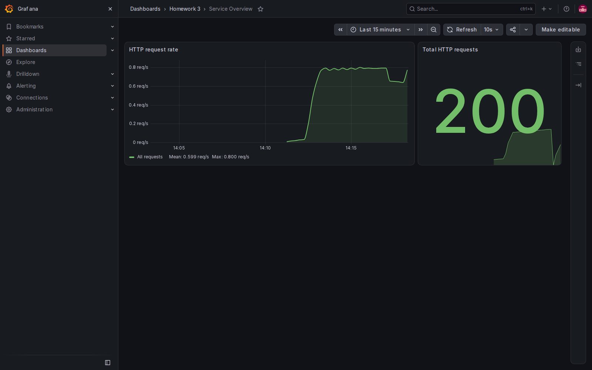
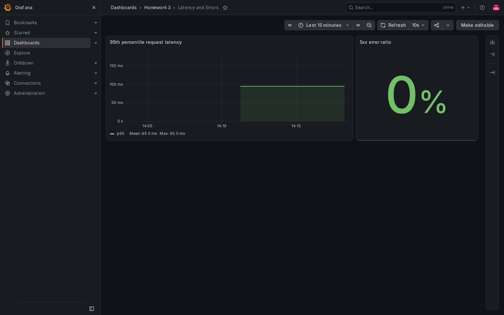

# Отчёт по домашним заданиям 3 и 4

## ДЗ 3: Docker и мониторинг Shop API

Shop API из ДЗ 2 запускается в Docker и экспортирует HTTP-метрики на `/metrics` с помощью prometheus-fastapi-instrumentator. Prometheus собирает их с `shop_api:8000`; Grafana подключается к Prometheus автоматически и загружает два дашборда.

### Состав

- `hw2/hw/Dockerfile` — образ Shop API.
- `hw2/hw/docker-compose.yml` — PostgreSQL, Shop API, Prometheus и Grafana в одной сети.
- `hw2/hw/settings/prometheus/prometheus.yml` — scrape target shop-api-local.
- `hw2/hw/settings/grafana/` — источник Prometheus, провайдер дашбордов и их JSON.
- `hw2/hw/screenshots/` — скриншоты дашбордов с метриками Shop API.

Запуск из корня репозитория:

```bash
docker compose -f hw2/hw/docker-compose.yml up --build -d
```

Shop API и его документация доступны по адресам http://localhost:8000 и http://localhost:8000/docs. Метрики доступны на http://localhost:8000/metrics, Prometheus — на http://localhost:9090, Grafana — на http://localhost:3000 (начальные учётные данные: admin / admin). В Prometheus цель shop-api-local должна иметь состояние UP.

Чтобы заполнить графики запросами к самому Shop API и получить несколько точек для графиков:

```bash
for batch in 1 2 3 4 5; do
  for i in $(seq 1 20); do
    curl -s -o /dev/null http://localhost:8000/item
    curl -s -o /dev/null http://localhost:8000/cart
  done
  sleep 10
done
```

Дашборд **Service Overview** показывает скорость и общее количество HTTP-запросов. **Latency and Errors** показывает p95 задержки и долю ответов 5xx. При штатной работе Shop API доля 5xx равна нулю.





## ДЗ 4: PostgreSQL и изоляция транзакций

Shop API хранит товары, корзины и позиции корзин в PostgreSQL через SQLAlchemy. Compose поднимает базу `hw4_db` и API; PostgreSQL опубликован на порту 7432. Данные сохраняются в именованном Docker-томе `shop_postgres_data`.

Пример создания товара и корзины:

```bash
curl -X POST http://localhost:8000/item \
  -H 'Content-Type: application/json' -d '{"name":"Кофе","price":350}'
curl -X POST http://localhost:8000/cart
```

Сценарии изоляции запускаются на двух соединениях. Скрипт перед каждым сценарием сбрасывает собственную таблицу `isolation_demo`:

```bash
docker compose -f hw2/hw/docker-compose.yml exec shop_api python /app/transaction_isolation.py
```

| Сценарий | Уровень изоляции | Наблюдение |
| --- | --- | --- |
| Dirty read | `READ UNCOMMITTED` и `READ COMMITTED` | Незакоммиченное значение не видно. PostgreSQL трактует `READ UNCOMMITTED` как `READ COMMITTED`, поэтому эту аномалию показать нельзя. |
| Non-repeatable read | `READ COMMITTED` | Повторное чтение видит изменение, зафиксированное параллельной транзакцией. |
| Non-repeatable read | `REPEATABLE READ` | Повторное чтение возвращает значение из исходного снимка транзакции. |
| Phantom read | `REPEATABLE READ` | Повторный диапазонный запрос возвращает прежний набор строк. PostgreSQL предотвращает phantom reads на этом уровне, хотя стандарт допускает их. |
| Phantom read | `SERIALIZABLE` | Повторный диапазонный запрос также сохраняет исходный результат. |

Остановить весь стенд, сохранив данные PostgreSQL:

```bash
docker compose -f hw2/hw/docker-compose.yml down
```
