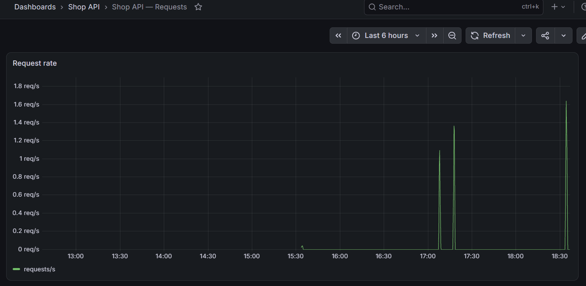
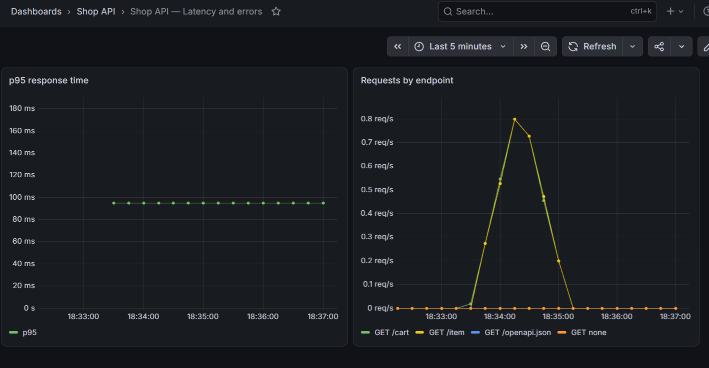

# Мониторинг HW 3

Compose запускает сервис магазина, Prometheus и Grafana:

```powershell
cd C:\itmo\python-backend-2026\hw2
docker compose up --build
```

После запуска доступны:

| Сервис | Адрес |
| --- | --- |
| Shop API | http://localhost:8000/docs |
| Метрики | http://localhost:8000/metrics |
| Prometheus | http://localhost:9090 |
| Grafana | http://localhost:3000 |

Учётные данные Grafana: `admin` / `admin`.

Grafana автоматически подключается к Prometheus и загружает два дашборда:

1. `Shop API — Requests` — скорость запросов.
2. `Shop API — Latency and errors` — p95 задержки и скорость запросов по маршрутам.

Перед скриншотами создай несколько товаров и корзин через Swagger UI. После
запросов подожди до 5 секунд: это интервал сбора метрик Prometheus. Скриншоты
обоих дашбордов приложи к PR.

## Скриншоты





Остановить окружение:

```powershell
docker compose down
```

Для удаления сохранённых данных Prometheus и Grafana вместе с окружением:

```powershell
docker compose down --volumes
```
