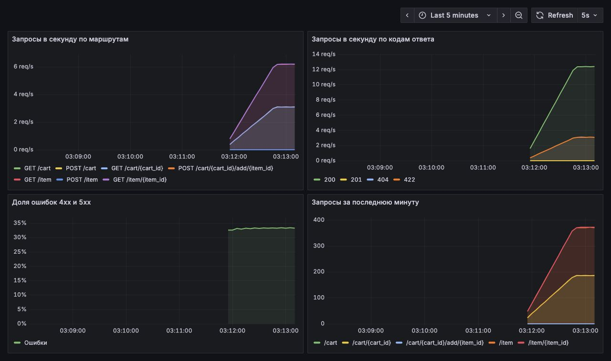

# HW3: Docker, Prometheus и Grafana

Задание: [lecture3/README.md](https://github.com/L1mple/python-backend-2026/blob/main/lecture3/README.md).

Используется наш Shop API из `hw2/hw/shop_api/main.py`, включая WebSocket-чат.
`hw3/main.py` подключает HTTP-метрики и эндпоинт `/metrics`.
Данные магазина по-прежнему хранятся в памяти одного процесса и теряются
при перезапуске сервиса.

## Запуск

Из корня репозитория, при запущенном Docker:

```sh
docker compose -f hw3/docker-compose.yml config --quiet
docker compose -f hw3/docker-compose.yml up -d --build --wait
```

| Сервис | Адрес |
| --- | --- |
| Shop API / Swagger | http://localhost:8080/docs |
| Метрики | http://localhost:8080/metrics |
| Prometheus targets | http://localhost:9090/targets |
| Grafana | http://localhost:3000 |

Порты доступны только на локальном компьютере. В Grafana включён просмотр
без авторизации; источник Prometheus и два дашборда в папке **HW3**
настраиваются автоматически. Метрики опрашиваются каждые 5 секунд.

Остановка:

```sh
docker compose -f hw3/docker-compose.yml down
```

## Нагрузка и дашборды

Скрипт использует стандартную библиотеку Python. Он создаёт товар и корзину,
а затем чередует успешные запросы и ожидаемые ошибки 404 и 422:

```sh
python3 hw3/load.py --duration 180
```

На графиках используются окна по одной минуте: после запуска нагрузки
подождите хотя бы минуту. Скрипт добавляет демонстрационные данные в магазин.

- [Запросы и ошибки](http://localhost:3000/d/shop-traffic): RPS по маршрутам,
  коды ответов, доля ошибок, количество запросов за минуту.
- [Время ответа](http://localhost:3000/d/shop-latency): p50/p95/p99, средняя
  задержка по маршрутам, память и CPU процесса.

Маршруты с ID объединяются в шаблоны (`/item/{item_id}`), а запросы
Prometheus к `/metrics` исключены из HTTP-метрик. Гистограмма содержит
границы от 1 мс, чтобы отображать быстрые ответы магазина.
HTTP-метрики не измеряют длительность WebSocket-сессий.

## Скриншоты

Скриншоты сняты с работающей Grafana при нагрузке от `load.py`:




## Локальные проверки

```sh
python3 -m venv .venv
.venv/bin/pip install -r hw3/requirements.txt -r hw2/hw/requirements.txt
PYTHONPATH=.:hw2/hw .venv/bin/python -m pytest \
  hw2/hw/test_homework2.py hw3/test_monitoring.py -v
```

В этом запуске исходные тесты HW2 работают с инструментированным приложением.
Дополнительные проверки проверяют группировку маршрутов, коды ошибок,
гистограмму задержек, исключение `/metrics` и пересылку сообщений WebSocket.

При разработке Docker Desktop не отвечал, поэтому контейнеры были собраны
и проверены в отдельном профиле Colima `hw3-check`. Prometheus подтвердил
состояние `up` для магазина, Grafana загрузила дашборды. Из-за проблемы
проброса портов Colima нагрузка запускалась внутри контейнера магазина,
а для скриншотов использовался временный локальный прокси к Grafana.
