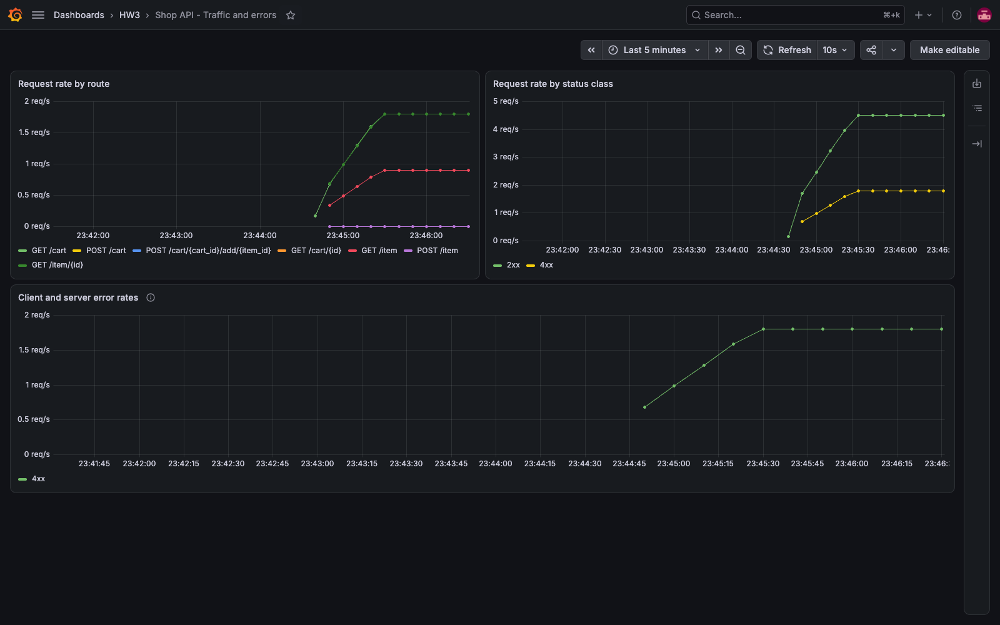
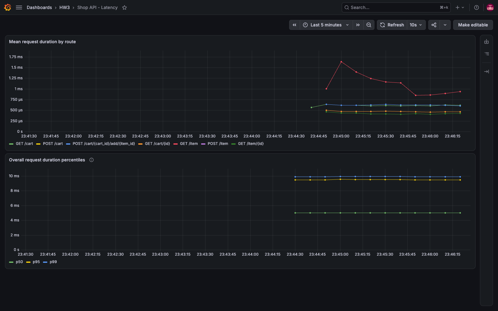

# ДЗ 3: Docker, Prometheus и Grafana

Используется наш [Shop API из ДЗ 2](../hw2/hw/shop_api/main.py) с товарами
(`/item`) и корзинами (`/cart`), а не учебный пример.
Реализация перенесена без изменений из `origin/genaev-hw-2`, коммит `501bbd7`.
[Точка входа HW3](main.py) импортирует тот же объект `app` и добавляет
Prometheus-инструментацию; бизнес-логика остаётся в `hw2/hw`.

Задание: [лекция 3](../lecture3/README.md).

## Запуск

Нужны Docker с Compose v2 или новее (например, запущенный Docker Desktop).
Из корня репозитория:

```sh
cd hw3
docker compose -p hw3-shop config --quiet
docker compose -p hw3-shop up -d --build
docker compose -p hw3-shop ps
```

Контекст сборки — корень репозитория (`..` относительно `hw3`).
Dockerfile копирует пакеты `hw2/hw/shop_api` и `hw2/hw/store`, а также
точку входа HW3. `Dockerfile.dockerignore` исключает остальные файлы,
включая локальные виртуальные окружения и скриншоты.

| Сервис | Адрес |
| --- | --- |
| Swagger UI | http://localhost:8080/docs |
| Метрики API | http://localhost:8080/metrics |
| Prometheus targets | http://localhost:9090/targets |
| Grafana | http://localhost:3000 |

Первый вход в Grafana: `admin` / `admin` (стандартные локальные учётные данные
образа). При первом входе можно сменить пароль или пропустить этот шаг для
локальной демонстрации. Порты привязаны только к `127.0.0.1`; конфигурация не
предназначена для публичного развёртывания.

Prometheus опрашивает `local:8080/metrics` каждые 10 секунд. Источник данных
Grafana обращается к `http://prometheus:9090` внутри сети Compose.
Источник и два дашборда в папке **HW3** создаются автоматически:

- [Shop API - Traffic and errors](http://localhost:3000/d/shop-traffic):
  частота запросов по маршрутам и методам, классы статусов, частота 4xx и 5xx.
- [Shop API - Latency](http://localhost:3000/d/shop-latency):
  средняя длительность по маршрутам и общие p50/p95/p99.

Графики используют окно `rate` в одну минуту и обновляются каждые 10 секунд.
После запуска нужны запросы к API и несколько опросов Prometheus.
Запросы к `/metrics` не учитываются в метриках; идентификаторы в маршрутах
объединяются в `/item/{id}`, `/cart/{id}` и `/cart/{cart_id}/add/{item_id}`.

Процентили рассчитываются по общей гистограмме
`http_request_duration_highr_seconds_bucket`, а не отдельно по маршрутам.
Её минимальная граница — 10 мс: меньшие значения оцениваются интерполяцией.
Класс 5xx не появляется до первого такого ответа; специально генерировать
ошибки сервера приложение не будет. При отсутствии запросов среднее и
процентили могут не отображаться.

## Запросы для заполнения графиков

Следующий ограниченный цикл создаёт товар и корзину, добавляет товар в корзину,
читает оба ресурса и проверяет ожидаемые ответы 404 и 422.
Нужны `curl`, Python 3 и POSIX-совместимая оболочка.
Запустите из отдельного терминала и затем откройте оба дашборда:

```sh
(
  set -eu
  item=$(curl -fsS -H 'Content-Type: application/json' \
    -d '{"name":"Milk","price":12.5}' http://localhost:8080/item)
  item_id=$(printf '%s' "$item" | python3 -c 'import json, sys; print(json.load(sys.stdin)["id"])')
  cart=$(curl -fsS -X POST http://localhost:8080/cart)
  cart_id=$(printf '%s' "$cart" | python3 -c 'import json, sys; print(json.load(sys.stdin)["id"])')
  i=0
  while [ "$i" -lt 120 ]; do
    curl -fsS http://localhost:8080/item > /dev/null
    curl -fsS http://localhost:8080/cart > /dev/null
    curl -fsS -X POST "http://localhost:8080/cart/$cart_id/add/$item_id" > /dev/null
    curl -fsS "http://localhost:8080/item/$item_id" > /dev/null
    curl -fsS "http://localhost:8080/cart/$cart_id" > /dev/null
    status=$(curl -sS -o /dev/null -w '%{http_code}' http://localhost:8080/item/-1)
    [ "$status" = 404 ] || { echo "Ожидался 404, получен $status" >&2; exit 1; }
    status=$(curl -sS -o /dev/null -w '%{http_code}' 'http://localhost:8080/cart?limit=0')
    [ "$status" = 422 ] || { echo "Ожидался 422, получен $status" >&2; exit 1; }
    i=$((i + 1))
    sleep 1
  done
  curl -fsS -X DELETE "http://localhost:8080/item/$item_id"
)
```

## Проверка и остановка

```sh
curl -fsS http://localhost:8080/item
curl -fsS http://localhost:8080/cart
curl -fsS http://localhost:8080/metrics
curl -fsS http://localhost:9090/-/ready
curl -fsS http://localhost:3000/api/health
docker compose -p hw3-shop exec prometheus \
  promtool check config /etc/prometheus/prometheus.yml
docker compose -p hw3-shop logs --tail=30
docker compose -p hw3-shop down
```

В Prometheus цель `shop-api` должна иметь состояние **UP**. В Grafana оба
дашборда должны показывать данные без ошибок источника или запросов.

Товары и корзины хранятся в памяти одного процесса и теряются при перезапуске API.
Именованные тома для истории Prometheus и настроек Grafana не настроены:
после `docker compose down` и нового запуска не следует рассчитывать на
сохранение этих данных. Источник данных и дашборды повторно создаются
из файлов в `settings/`.

Для тестов нужен Python 3.12 или новее. Из корня репозитория:

```sh
python3 -m venv .venv
. .venv/bin/activate
python -m pip install -r hw2/hw/requirements.txt -r hw3/requirements.txt
PYTHONPATH="$PWD/hw2/hw" python -m pytest -q \
  hw2/hw/test_homework2.py hw3/test_monitoring.py
```

Запускаются исходные 39 тестов ДЗ 2 и три теста мониторинга: использование
того же объекта приложения, сценарий товар–корзина и метрики запросов.
`PYTHONPATH` сохраняет исходный способ импорта `shop_api` и `store` из ДЗ 2.

## Материалы для PR

- [Dockerfile](Dockerfile) и [docker-compose.yml](docker-compose.yml).
- [Конфигурация Prometheus](settings/prometheus/prometheus.yml),
  [provisioning Grafana](settings/grafana/provisioning/) и
  [дашборды](settings/grafana/dashboards/).
- Скриншоты работающих дашбордов с реальными запросами:





В PR нужны `hw3/` и реализация Shop API в `hw2/hw/`, если она ещё не включена
в целевую ветку. Приложение не дублируется внутри HW3.
