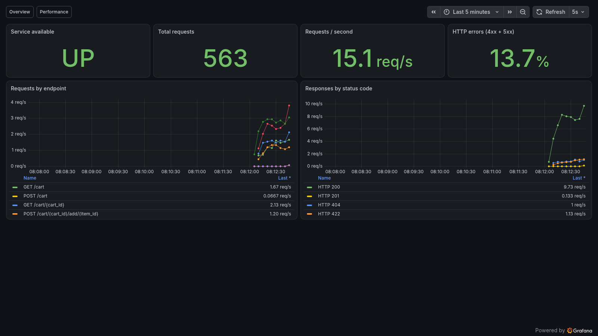
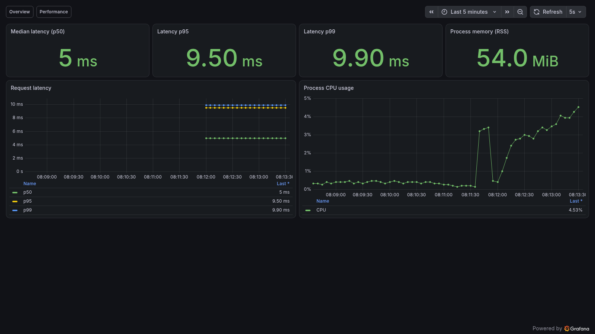

# ДЗ 3: Docker и мониторинг

Используется магазин из ДЗ 2. `main.py` подключает к нему метрики Prometheus
и проверку доступности `/health`; код магазина остаётся в `hw2/hw/shop_api`.

## Запуск

Из корня репозитория:

```sh
docker compose -f hw3/docker-compose.yml up --build -d
```

На этом Mac команда `docker` указывает на Podman. Для уже запущенной Colima
можно обратиться к настоящему Docker Compose напрямую:

```sh
DOCKER_HOST="unix://$HOME/.colima/default/docker.sock" /opt/homebrew/bin/docker-compose -f hw3/docker-compose.yml up --build -d
```

- API и Swagger: http://localhost:8080/docs
- Метрики: http://localhost:8080/metrics
- Prometheus: http://localhost:9090
- Grafana: http://localhost:3000

В Grafana автоматически создаются источник Prometheus и папка **Shop API**
с двумя дашбордами:

- [Overview](http://localhost:3000/d/shop-overview): доступность сервиса,
  количество и частота запросов, ошибки, распределение по ручкам и статусам.
- [Performance](http://localhost:3000/d/shop-performance): задержки p50/p95/p99,
  память и CPU процесса.

Просмотр доступен без входа. Для администрирования: `admin` / `admin`;
пароль можно задать переменной `GRAFANA_ADMIN_PASSWORD` перед первым запуском.
Порты опубликованы только на localhost.

## Данные для графиков

После запуска контейнеров:

```sh
python3 hw3/load.py --duration 120
```

Скрипт создаёт товар и корзину, отправляет обычные запросы и запросы с ожидаемыми
ошибками 404/422. Prometheus собирает метрики каждые 5 секунд. Для расчёта скорости
и перцентилей нужно несколько сборов; в первые секунды панели могут быть пустыми.

## Проверка

```sh
docker compose -f hw3/docker-compose.yml ps
docker compose -f hw3/docker-compose.yml exec prometheus promtool check config /etc/prometheus/prometheus.yml
```

На странице http://localhost:9090/targets цель `shop-api` должна быть в состоянии **UP**.
Для локальных Python-тестов установите зависимости из `hw2/hw/requirements.txt`
и `hw3/requirements.txt`, затем выполните из корня репозитория:

```sh
PYTHONPATH=hw2/hw:. python -m pytest hw2/hw/test_homework2.py hw2/hw/test_shop_api.py hw3/test_monitoring.py
```

## Скриншоты Grafana

Скриншоты получены из запущенной Grafana после отправки запросов скриптом `load.py`.





Чтобы повторить экспорт PNG без браузера, запустите дополнительный контейнер
официального Grafana Image Renderer:

```sh
docker compose -f hw3/docker-compose.yml -f hw3/docker-compose.render.yml --profile screenshots up -d
mkdir -p hw3/screenshots
curl -f 'http://localhost:3000/render/d/shop-overview?from=now-5m&to=now&width=1600&height=900&tz=Europe%2FMoscow&theme=dark&kiosk' -o hw3/screenshots/overview.png
curl -f 'http://localhost:3000/render/d/shop-performance?from=now-5m&to=now&width=1600&height=900&tz=Europe%2FMoscow&theme=dark&kiosk' -o hw3/screenshots/performance.png
```

Renderer нужен только для экспорта; для обычного просмотра дашбордов достаточно
основного Compose-файла. После экспорта можно остановить renderer:

```sh
docker compose -f hw3/docker-compose.yml -f hw3/docker-compose.render.yml --profile screenshots stop renderer
```

## Остановка

```sh
docker compose -f hw3/docker-compose.yml down
```

Если запускали renderer:

```sh
docker compose -f hw3/docker-compose.yml -f hw3/docker-compose.render.yml --profile screenshots down
```

Данные Prometheus и настройки Grafana сохраняются в именованных Docker volumes.
Товары и корзины хранятся в памяти магазина и сбрасываются при его перезапуске.
