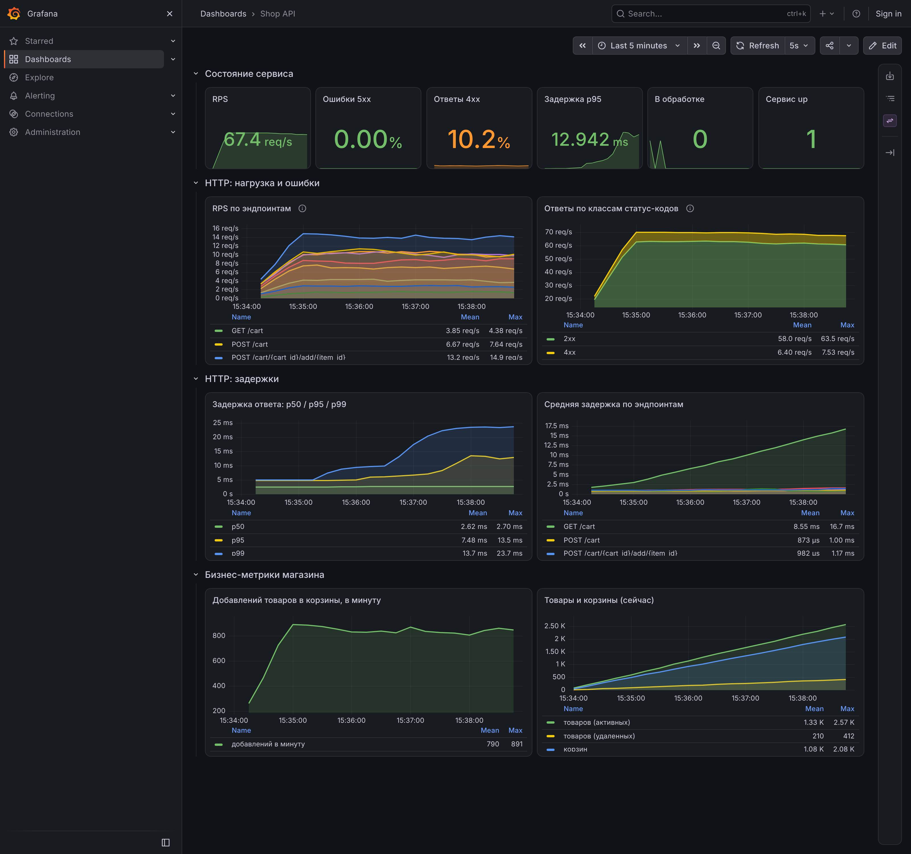
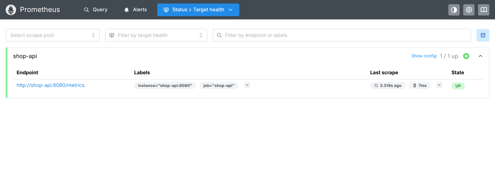

# ДЗ3: Docker, Prometheus и Grafana для Shop API

В этой работе сервис из ДЗ2 (REST + RPC API магазина `shop_api`) упакован в Docker
и подключен к мониторингу: Prometheus собирает метрики сервиса, Grafana показывает
их на готовом дашборде.

Код сервиса скопирован из [hw2/hw/shop_api](../hw2/hw/shop_api/main.py), в него добавлены только метрики
(так что сам код ДЗ2 и его тесты не затронуты).

## Что внутри

| Файл | Назначение |
|---|---|
| [`Dockerfile`](./Dockerfile) | сборка образа сервиса (python 3.13, запуск от обычного пользователя, healthcheck) |
| [`docker-compose.yml`](./docker-compose.yml) | локальный стенд: сервис + Prometheus + Grafana (+ генератор нагрузки по профилю `load`) |
| [`shop_api/main.py`](./shop_api/main.py) | сервис из ДЗ2 + метрики на `GET /metrics` |
| [`settings/prometheus/prometheus.yml`](./settings/prometheus/prometheus.yml) | конфиг Prometheus (сбор метрик с сервиса каждые 5 секунд) |
| [`settings/grafana/`](./settings/grafana) | автоматическая настройка Grafana: источник данных и дашборд `Shop API` |
| [`load.py`](./load.py) | генератор нагрузки, чтобы на дашбордах были данные |

## Как запустить

Нужен установленный Docker с Docker Compose. Из папки `hw3`:

```sh
docker compose --profile load up --build
```

Профиль `load` дополнительно запускает генератор нагрузки. Без него поднимутся только
сервис, Prometheus и Grafana (`docker compose up --build`), а нагрузку можно
создать самому, например `python load.py`.

После запуска доступны:

- Shop API: http://localhost:8080 (документация http://localhost:8080/docs, метрики http://localhost:8080/metrics)
- Prometheus: http://localhost:9090 (статус сбора метрик: http://localhost:9090/targets)
- Grafana: http://localhost:3000, дашборд **Shop API** открывается сразу, логин не нужен
  (вход без пароля включен только для локального стенда)

Остановить: `docker compose --profile load down` (с флагом `-v` еще и удалятся накопленные данные).

## Какие метрики собираются

Технические (библиотека `prometheus-fastapi-instrumentator`):

- `http_requests_total{method, handler, status}` - число запросов (статусы сгруппированы: 2xx, 4xx, 5xx);
- `http_request_duration_seconds` - гистограмма времени ответа по методу и пути;
- `http_requests_inprogress` - запросы, обрабатываемые прямо сейчас.

Бизнес-метрики магазина:

- `shop_items{state="active|deleted"}` - число активных и удаленных товаров;
- `shop_carts` - число корзин;
- `shop_cart_additions_total` - сколько раз товары добавляли в корзины.

## Дашборд Grafana

Дашборд описан в [`settings/grafana/dashboards/shop-api.json`](./settings/grafana/dashboards/shop-api.json)
и подключается автоматически. На нем:

- **Состояние сервиса**: RPS, доля ошибок 5xx и ответов 4xx, задержка p95, запросы в обработке, статус `up`;
- **HTTP: нагрузка и ошибки**: RPS по эндпоинтам, ответы по классам статус-кодов;
- **HTTP: задержки**: p50 / p95 / p99 и средняя задержка по эндпоинтам;
- **Бизнес-метрики**: добавления товаров в корзины, число товаров и корзин.



Prometheus успешно собирает метрики с сервиса (цель `shop-api` в состоянии UP):


